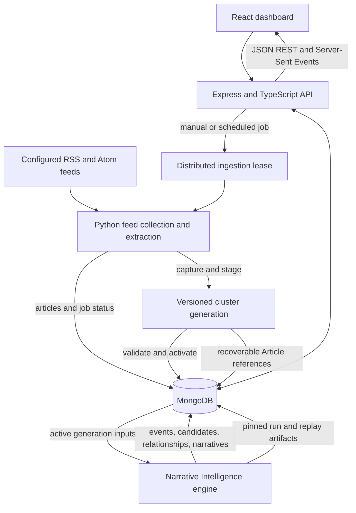

# Traceon — News Intelligence Platform

**Traceon — News Intelligence Platform** is a news monitoring and narrative analysis application. It collects configured RSS/Atom feeds, stores and deduplicates articles, groups similar coverage into event clusters, and evaluates links between separate events to show how a larger story may develop over time.

> **Interpretation boundary:** Traceon tracks how reports and related events appear and evolve. The application does not establish whether a claim is true, detect misinformation with a fact-checking model, or replace editorial verification. Its relationship labels are machine-generated assessments supported by article evidence and can be reviewed by a person.

## Project overview

News about one incident is often spread across multiple publishers and articles. Reading each report independently makes it difficult to see cross-publisher coverage, distinguish a continuing development from a similar but unrelated event, or understand when a story changed. Traceon combines a collection pipeline, event clustering, temporal visualization, and a separate narrative relationship engine.

The application has two related analysis levels:

1. **Event clustering:** groups articles that appear to cover the same incident.
2. **Narrative analysis:** evaluates whether different event clusters represent the same occurrence, a later development, broader context, an unrelated event, or an uncertain case.

The system is designed for explainability and review. It stores article references, evidence, run inputs, software versions, and human-review decisions so analysts can inspect why a relationship was suggested.

## Goals and expected impact

- **Reduce repetitive reading:** group multiple publishers’ reports about one event into a cluster.
- **Expose coverage diversity:** show which publishers reported an event and how reporting volume changes over time.
- **Make development patterns visible:** connect event clusters when article-level evidence supports a response, investigation, legal action, escalation, or resolution.
- **Preserve uncertainty:** use `INSUFFICIENT_EVIDENCE` when the text cannot support a safe conclusion.
- **Support human judgment:** let reviewers confirm or reject a proposed relationship without deleting source articles or clusters.
- **Improve operational reliability:** coordinate ingestion and cluster rebuilds with distributed leases, fencing tokens, staged generations, and recoverable reference updates.
- **Make analysis auditable:** pin the exact inputs and software versions used for narrative runs and support isolated replay.

## Main capabilities

### News collection and publisher management

- Reads enabled publisher and feed records from MongoDB.
- Fetches RSS and Atom feeds with Python `feedparser`.
- Canonicalizes article URLs by removing query strings and fragments for duplicate handling.
- Cleans feed titles and summaries, checks for English-language content, and attempts full-text extraction with `trafilatura`.
- Uses article URLs as the primary duplicate key and can backfill a missing article body when a later fetch succeeds.
- Records ingestion job status, article counts, duplicate counts, failed feeds, and feed health.
- Supports manual ingestion from the dashboard and an optional recurring RSS scheduler.
- Lets an operator manage publishers and feeds, test a feed URL, and review source status.

The checked-in publisher registry currently contains **22 source definitions** across international media, Indian media, Indian government, regulator, and international official source categories. Active feeds are controlled by publisher/feed enablement plus an explicit retired-source policy. The selected retired publishers are excluded from ingestion and active publisher views; their historical article data is retained. RBI Press Releases remains configured, while the RBI Notifications feed is excluded.

Baseline publisher definitions:

- **Existing international media (3):** BBC, NPR, The Guardian.
- **Indian media (10):** The Hindu, The Indian Express, NDTV, The Times of India, Hindustan Times, Mint, ThePrint, Scroll.in, LiveLaw, Alt News.
- **Indian government (1):** PIB Regional.
- **Indian regulators and alerts (2):** RBI Press Releases, NDMA SACHET.
- **International official sources (6):** US Federal Reserve, UK Government, World Health Organization, NASA, US SEC, European Commission.

### Event clustering and quality assessment

- Uses TF-IDF text vectors and cosine similarity to find lexically similar articles.
- Creates connected components: articles connected through qualifying similarity links are assigned to the same generated event cluster.
- Produces a cluster label, top terms, article membership, source list, article count, and publication time range.
- Assesses cluster coherence using headline, summary, body, entity, distinctive-term, and topic-conflict signals.
- Produces a human-readable score from **0 to 100**, supporting evidence, and flags such as `LOW_TOPIC_COHERENCE`, `ENTITY_MISMATCH`, `POSSIBLE_MIXED_CLUSTER`, and `LIMITED_ARTICLE_CONTENT`.
- Treats cluster quality as diagnostic: it does not automatically remove articles, split clusters, or reassign membership.

The default persistent clustering input window is the **200 most recently published articles** (`MAX_ARTICLES_FOR_CLUSTERING=200`). The default similarity threshold is **0.26** (`SIMILARITY_THRESHOLD=0.26`). The interactive playground runs a non-persistent preview on a bounded recent article set and allows a threshold to be adjusted without changing stored clusters.

### Narrative Intelligence

The engine builds article-level features from each current event cluster, then performs a multi-stage analysis:

1. **Event feature extraction:** reads member headlines, summaries, body text, dates, categories, and named entities; it also carries cluster-quality warnings and identifies suspected outlier articles.
2. **Candidate discovery:** uses distinctive headline terms and specific entities to find plausible pairs without generating the full Cartesian product of all event pairs. Generic terms alone do not create candidates.
3. **Candidate relevance gate:** scores candidate pairs on a 0–100 scale using distinctive terms, entity specificity, topic compatibility, temporal evidence, continuity cues, and cluster-quality warnings. The default threshold is 42 and is configurable with `NARRATIVE_CANDIDATE_RELEVANCE_THRESHOLD`.
4. **Relationship classification:** evaluates evidence across compatible member-article pairs, including chronology and contradictory evidence. A shared company, person, government, or generic stage word is not sufficient by itself to prove continuity.
5. **Grouping:** groups accepted direct relationships under guarded rules to limit weak transitive bridges. Same-event links use complete-link checks across groups; a continuing-storyline link can form a new pair but is not used as a single weak bridge into a larger existing group.
6. **Persistence:** stores event features, relationship evidence, candidate diagnostics, narrative groups, run versions, and review history.

The five relationship classifications are:

| Classification | Meaning |
|---|---|
| `SAME_EVENT` | Different reports describe the same identifiable occurrence. |
| `CONTINUING_STORYLINE` | Reports describe distinct but specifically connected developments in one underlying story. |
| `BROADER_CONTEXT_ONLY` | Reports share a meaningful topic or context, but evidence does not establish one connected storyline. |
| `UNRELATED` | Available evidence supports treating the reports as separate stories. |
| `INSUFFICIENT_EVIDENCE` | Available information is too sparse or ambiguous to establish or rule out a meaningful link. |

The implementation records supporting article pairs, shared specific entities, distinctive terms, temporal interpretation, continuity indicators, cluster-quality warnings, and reasons for candidate inclusion or exclusion. Machine runs do not overwrite existing human `CONFIRMED` or `REJECTED` decisions; prior machine evaluations are retained in history when re-evaluated.

### Reproducible narrative runs and replay

Each new narrative run records its run ID, ingestion job (when applicable), cluster generation, exact cluster and article IDs, input fingerprint and capture time, candidate threshold, engine versions, and run configuration. Immutable `narrative_run_inputs` documents contain the cluster metadata and article text used by the run. Later changes to a live Article or Cluster therefore do not silently change saved run inputs.

A diagnostic replay runs against a specified run’s pinned inputs, including an inactive historical generation. Replay results are stored as separate run artifacts linked to the original run; they do not overwrite live relationships or review state. Replay reports missing or changed inputs and version drift instead of substituting current live data.

### Cluster generation lifecycle and ingestion coordination

Cluster rebuilds use a staged, versioned lifecycle:

1. Capture the exact article IDs and content fingerprint for the generation.
2. Build new clusters in a staging state while leaving the currently active generation available.
3. Validate that generated clusters partition the captured article set and that captured article content has not changed.
4. Activate the validated generation through a compare-and-set against the control document and its fencing token.
5. Update Article-to-Cluster references idempotently after activation.
6. Recover interrupted reference updates without rolling back an already activated generation.

Historical Cluster documents are retained. Current cluster and narrative analysis filters for the active generation, so staged or inactive clusters are not treated as current input. The ingestion lease is shared between backend and scraper; fencing tokens prevent an expired worker from publishing as a newer worker. A successful ingestion can trigger one associated post-ingest narrative run, and a failed narrative attempt can be retried without repeating ingestion.

This lifecycle is designed for MongoDB deployments without multi-document transactions. It reduces the risk of competing rebuilds and partial publication, but it does not automatically repair legacy dangling references or delete historical generations.

## User interface

The React dashboard includes:

- **Live feed:** incoming articles with publisher, category, country, publication time, status, and cluster assignment; supports source, category, and text filters.
- **Cluster board:** grouped stories and single articles with source badges, top terms, search, date/topic filters, and cluster details.
- **Signal map:** visual overview of event clusters, with cluster size and source diversity represented in the display.
- **Timeline:** chronological view of event-cluster reporting windows.
- **Narrative Intelligence:** narrative overview, relationship review, evidence details, event timeline, and analysis controls.
- **Publisher Management:** publisher cards, feed listings, add/test feed controls, enable/disable controls, and source health details.
- **Monitoring:** scheduler state, active source/feed counts, feed health, recent ingestion jobs, and collection statistics.
- **Presentation controls:** dark/light appearance and dashboard refresh.

The failed-feed count remains an internal ingestion diagnostic. The RSS Collection summary displays stored article, newly discovered, duplicate-skipped, and last-successful-collection metrics.

## System architecture



### End-to-end operation

1. **Start-up:** the backend connects to MongoDB and seeds BBC, NPR, and The Guardian only when the publisher collection is empty.
2. **Source selection:** the scraper reads enabled publishers and feeds from MongoDB. A small static RSS fallback is used only if no feed targets are available. Retired publishers and feed URLs are filtered at the scraper boundary.
3. **Job coordination:** a manual request or optional scheduler tick attempts to acquire the distributed ingestion lease. The backend creates an ingestion job, then starts the Python pipeline as a child process with the job ID and fencing token.
4. **Fetch and normalize:** the scraper fetches feed documents, validates language, canonicalizes URLs, and extracts article body text where the site permits it.
5. **Deduplicate and persist:** existing URLs are counted as duplicates; missing bodies can be backfilled. New articles are stored in MongoDB.
6. **Cluster rebuild:** after successful feed collection, the scraper captures the configured recent article window, stages and validates a new cluster generation, and activates it only if the lease/fencing compare-and-set succeeds.
7. **Post-ingest narrative analysis:** after ingestion and generation activation complete successfully, the backend can trigger the narrative engine against that generation. The engine snapshots its exact inputs and saves run diagnostics.
8. **Dashboard updates:** the API supplies JSON payloads; Server-Sent Events notify open clients about ingestion completion and new live articles.

## Technology stack

| Area | Technology | Role |
|---|---|---|
| Frontend | React 19, JavaScript/JSX | Dashboard views, filters, state, and evidence interaction. |
| Frontend build | Vite 8 | Local development server and optimized production bundle. |
| Styling and icons | CSS, Lucide React | Responsive dashboard presentation and interface icons. |
| API | Node.js, Express 5, TypeScript | REST endpoints, job coordination, publisher management, and narrative persistence. |
| MongoDB access | Mongoose 9 (backend), PyMongo (scraper) | Document models, indexes, atomic updates, and Python pipeline access. |
| RSS parsing | Python `feedparser` | Parses RSS/Atom documents for ingestion. |
| Article extraction | `trafilatura` | Attempts extraction of readable article text from publisher pages. |
| Clustering | Python, scikit-learn, NumPy | TF-IDF vectorization, cosine similarity, and connected-component clustering. |
| Narrative analysis | TypeScript rules and evidence scoring | Entity/term extraction, candidate relevance, relationship classification, grouping, and diagnostics. |
| Feed validation | `fast-xml-parser` | Parses a submitted feed sample in publisher-management validation. |
| Configuration | `python-dotenv`, Node `dotenv` | Loads local environment configuration. |
| Testing | Node test runner through `tsx`; Python `unittest` | Validates backend rules, concurrency/lifecycle logic, and scraper behavior. |
| Local infrastructure | Docker Compose, MongoDB 7 image | Provides an optional local MongoDB service. |

### Why these technologies fit

- **MongoDB** stores variable publisher content and keeps event membership, evidence arrays, histories, and snapshots in document form. Atomic single-document updates support leases and compare-and-set transitions without requiring replica-set transactions.
- **Python/scikit-learn** provides a mature sparse TF-IDF and cosine-similarity implementation for clustering.
- **TypeScript/Express** hosts the API and narrative rules in one service, with types around classifications and persisted run fields.
- **React/Vite** provides interactive dashboard views and a fast local build workflow.
- **Rule-based evidence scoring** is deterministic and inspectable; article content is not sent to a paid external AI service.

## Data model and MongoDB collections

The default database name is `news-pulse`; it can be changed with `MONGO_DB`.

| Collection | Purpose |
|---|---|
| `articles` | Publisher reports with title, summary, body, URL, source, language, dates, content hash, processing status, and cluster reference. |
| `publishers` | Publisher metadata and embedded RSS feed configurations, enablement, health, and ingestion metrics. |
| `clusters` | Event clusters, article IDs, label, top terms, sources, time range, and generation ID/fencing token. Legacy clusters can have a null generation ID. |
| `cluster_generations` | Captured input IDs/fingerprint, staged cluster IDs, validation result, lifecycle state, and reference-update status. |
| `cluster_generation_controls` | Singleton active-generation and ingestion-lease control with fencing token and latest job transition. |
| `ingestjobs` | Manual/scheduled ingestion status, counts, feed failures, generation ID, and post-ingest narrative status. |
| `narrative_events` | Normalized event features derived from clusters, article facets, entities, quality assessment, and history. |
| `narrative_relationships` | Pairwise machine classification, candidate evidence, explanation, review decision, and evaluation history. |
| `narratives` | Child storylines and parent broader-context groupings, event keys, status, and history. |
| `narrative_runs` | Run trigger/status, pinned input IDs and fingerprint, versions/configuration, candidate diagnostics, and result counts. |
| `narrative_run_inputs` | Immutable per-run copies of the exact cluster and article payloads used for replay. |
| `narrative_run_artifacts` | Machine-only replay candidates, relationships, and groups, separate from live relationships and review. |
| `narrative_locks` | Expiring global lock for Narrative Intelligence execution. |

### Integrity and retention principles

- Publisher retirement changes active collection and display behavior; it does not erase historical Articles or publisher strings.
- Cluster rebuilds retain old Cluster documents and generations rather than deleting them when the active generation changes.
- Human `CONFIRMED` and `REJECTED` states remain separate from machine classifications.
- Narrative replay writes separate machine artifacts and does not alter the original run or live reviewer decisions.
- Existing legacy reference issues are not repaired automatically by the current pipeline.

## Important algorithms and configuration defaults

### Persistent clustering

- Input: up to 200 most recently published Articles by default.
- Document text: headline, summary, and the first 3,000 characters of body text.
- Vectorization: lowercase, English stop words, unigram and bigram features, `min_df=1`, `max_df=0.85`.
- Similarity: cosine similarity between TF-IDF vectors.
- Grouping: connected components over article pairs meeting the threshold.
- Default threshold: `0.26`.
- Output labels: highest-weight terms in a component, or the article title for a singleton.

### Cluster-quality assessment

- Score range: **0–100**, where higher means stronger internal evidence that members belong together.
- Signals: headline similarity, summary similarity, body similarity when enough content exists, important entity overlap, distinctive-term overlap using a broader corpus, topic evidence, and conflict evidence.
- Headlines and summaries carry more topic weight than body-only categories.
- Limited article text is unavailable evidence; unavailable evidence is not automatically a mismatch.
- A singleton is insufficient to establish within-cluster agreement, but it is not marked content-limited when its body/summary is sufficiently long.
- Output includes individual signal values, evidence samples, flags, suspected outlier IDs, and a plain-language explanation.

### Candidate relevance

- Default threshold: **42/100**; set with `NARRATIVE_CANDIDATE_RELEVANCE_THRESHOLD`.
- Candidate discovery is indexed by distinctive title terms and specific entity types; generic words do not create pairs on their own.
- High-fanout keys are bounded and reported in diagnostics.
- Each considered pair has a score and evidence. Run diagnostics retain aggregate counts, score bins, exclusion reasons, and representative excluded pairs rather than storing a full Cartesian product.

### Current Narrative Intelligence versions

- Narrative rules: `rules-en-v1.1.0`
- Candidate gate: `candidate-relevance-v2`
- Classifier: `article-evidence-v1`
- Cluster quality: `cluster-quality-v1.1`

## API overview

The backend runs on port `5050` by default. Routes return JSON in a `{ success, data }` envelope; the frontend client unwraps `data`.

### Clusters and articles

| Method | Endpoint | Purpose |
|---|---|---|
| `GET` | `/clusters` | List current active-generation cluster summaries; accepts source filters. |
| `GET` | `/clusters/:id` | Get a cluster and its member articles. |
| `GET` | `/clusters/playground?threshold=0.26` | Generate a non-persistent clustering preview. |
| `GET` | `/timeline` | Get current clusters as timeline data. |
| `GET` | `/articles` | Retrieve recent articles, optionally filtered by source. |

### Ingestion and monitoring

| Method | Endpoint | Purpose |
|---|---|---|
| `POST` | `/ingest/trigger` | Start a manual RSS ingestion job; returns conflict if another job owns the lease. |
| `GET` | `/ingest/status/:jobId` | Read ingestion and post-ingest narrative job status. |
| `POST` | `/ingest/status/:jobId/retry-narrative` | Retry an eligible narrative attempt without repeating RSS ingestion. |
| `GET` | `/ingest/summary` | Read article and latest successful collection metrics. |
| `GET` | `/ingest/live` | Read recent live-feed articles; supports publisher and source-category filters. |
| `GET` | `/ingest/live-stream` | Server-Sent Events for live article and ingestion completion updates. |
| `GET` | `/ingest/monitoring` | Read scheduler, publisher/feed health, and recent job history. |

### Publishers

| Method | Endpoint | Purpose |
|---|---|---|
| `GET` | `/publishers` | List active publisher definitions and article/feed counts. |
| `POST` | `/publishers` | Add a publisher and feed definitions. |
| `POST` | `/publishers/test-feed` | Validate a submitted RSS/Atom URL and inspect a small sample. |
| `GET` | `/publishers/:id` | Read a publisher record. |
| `PUT` | `/publishers/:id` | Update publisher metadata or feeds. |
| `PATCH` | `/publishers/:id/toggle` | Enable or disable a publisher. |
| `DELETE` | `/publishers/:id` | Remove a publisher configuration record; this endpoint should not be used to clean historical articles. |

### Narrative Intelligence

| Method | Endpoint | Purpose |
|---|---|---|
| `GET` | `/narratives/status` | Read engine configuration, counts, and latest run. |
| `GET` | `/narratives` | List narratives; supports status, level, category, source, and review filters. |
| `GET` | `/narratives/:id` | Get a narrative with children/events, article evidence, and relationships. |
| `GET` | `/narratives/:id/history` | Read narrative/event history. |
| `GET` | `/narratives/:id/timeline` | Read events in chronological order. |
| `GET` | `/narratives/relationships` | List relationship classifications and review state. |
| `PATCH` | `/narratives/relationships/:id/review` | Update a relationship review status and note. |
| `POST` | `/narratives/analyze` | Trigger manual Narrative Intelligence analysis. |
| `GET` | `/narratives/runs/latest` | Read the latest run metadata. |
| `POST` | `/narratives/runs/:runId/replay` | Replay a run against its pinned inputs. |
| `GET` | `/narratives/runs/:runId/artifacts` | Read machine-only replay artifacts. |

## Repository structure

```text
backend/
  config/                   Mongo connection and retired-source policy
  controllers/              HTTP request handlers
  data/                     Publisher registry and explicit sync utility
  models/                   Mongoose schemas for articles, clusters, runs, reviews
  routes/                   Express route registration
  services/                 Ingestion orchestration, lifecycle, narrative engine/replay
  utils/                    API and language utilities
frontend/
  src/App.jsx               Dashboard views and application shell
  src/App.css               Application styling
  src/main.jsx              Vite/React entry point
  public/                   Public assets
scraper/
  feeds/                    RSS fetching, language checks, source exclusions
  extractor/                Full-text extraction helper
  clustering/               Persistent Python TF-IDF clustering
  database/                 MongoDB collections and indexes for scraper
  pipeline.py               Coordinated ingestion worker
  cluster_lifecycle.py      Staged cluster generation lifecycle
  ingestion_coordination.py Shared lease/fencing primitives
  tests/                    Isolated lifecycle, coordination, and feed-policy tests
data/backup/                 JSON exports of historical application collections
prototypes/                 Read-only narrative analysis experiments and reports
docs/narrative_intelligence/ Narrative architecture, evaluation, and audit reports
```

## Local development setup

### Requirements

- Node.js and npm (Node 22 is used by the provided backend Dockerfile).
- Python 3.10+ with pip.
- MongoDB 7 locally, or Docker Desktop for the provided MongoDB Compose service.
- Network access from the scraper to configured RSS feeds and publisher article pages.

### 1. Start MongoDB

From the repository root:

```bash
docker compose up -d mongo
```

This starts MongoDB on `127.0.0.1:27017` and stores files in the `mongo-data` Docker volume. Compose starts MongoDB only, not the frontend or backend. Alternatively, connect to another MongoDB server and set `MONGO_URI` and `MONGO_DB` accordingly.

### 2. Install Python dependencies

From the repository root:

```bash
python -m pip install -r scraper/requirements.txt
```

### 3. Configure and start the backend

Create `backend/.env` as needed:

```dotenv
PORT=5050
MONGO_URI=mongodb://127.0.0.1:27017/news-pulse
MONGO_DB=news-pulse
PYTHON_BIN=python
SCRAPER_ENTRYPOINT=../scraper/pipeline.py
AUTO_RSS_POLLING=false
RSS_POLL_INTERVAL_MINUTES=1
MAX_ARTICLES_FOR_CLUSTERING=200
SIMILARITY_THRESHOLD=0.26
INGESTION_LEASE_SECONDS=120
NARRATIVE_ANALYSIS_ENABLED=true
NARRATIVE_SHADOW_MODE=true
NARRATIVE_MAX_EVENT_CLUSTERS=500
NARRATIVE_INACTIVE_DAYS=45
NARRATIVE_LEASE_MINUTES=30
NARRATIVE_CANDIDATE_RELEVANCE_THRESHOLD=42
```

Install and run:

```bash
cd backend
npm ci
npm run dev
```

The API is available at `http://localhost:5050`. If the MongoDB publisher collection is empty, the server seeds BBC, NPR, and The Guardian. The broader 22-source registry is in `backend/data/publisherRegistry.py`; it can be synchronized explicitly by running the utility from its directory after confirming the target MongoDB connection:

```bash
cd backend/data
python sync_publishers.py
```

The sync utility uses the local `news-pulse` MongoDB connection coded in that script. It inserts or updates publisher configurations; it is not a historical data cleanup tool.

To enable recurring RSS polling, set `AUTO_RSS_POLLING=true`. The default interval is one minute unless `RSS_POLL_INTERVAL_MINUTES` is changed. Manual ingestion remains available through the dashboard/API when automatic polling is disabled.

### 4. Start the frontend

Create `frontend/.env` if the API is not at its default address:

```dotenv
VITE_API_BASE_URL=http://localhost:5050
```

Then run:

```bash
cd frontend
npm ci
npm run dev
```

Vite prints the local dashboard URL, normally `http://localhost:5173`.

### Narrative scheduling note

Post-ingest narrative analysis is initiated after a successful ingestion and active-generation check. Analysts can also trigger it through the UI or `POST /narratives/analyze`. The service contains a recurring narrative scheduler helper and an interval setting, but the current `backend/server.ts` startup path does **not** call that helper. Do not assume a separate periodic narrative timer runs unless startup wiring is changed.

## Verification commands

Backend Node/TypeScript tests:

```bash
cd backend
npm test
```

Backend TypeScript type check:

```bash
cd backend
npx tsc --noEmit --project tsconfig.json
```

Scraper unit tests:

```bash
python -m unittest discover -s scraper/tests -p "test_*.py"
```

Frontend production build:

```bash
cd frontend
npm run build
```

Whitespace and patch checks:

```bash
git diff --check
```

Backend tests cover narrative extraction/classification, cluster quality, candidate-gate behavior, grouping, run snapshots/replay, review protection, ingestion coordination, and generation lifecycle. Python tests cover isolated cluster-generation failures, lease/fencing behavior, and retired-source filtering.

## Configuration reference

| Variable | Default | Purpose |
|---|---:|---|
| `PORT` | `5050` | Express API port. |
| `MONGO_URI` / `MONGODB_URI` | `mongodb://127.0.0.1:27017/news-pulse` | MongoDB connection URI. |
| `MONGO_DB` | `news-pulse` | Database name. |
| `PYTHON_BIN` | `python` | Python executable spawned by the backend. |
| `SCRAPER_ENTRYPOINT` | `../scraper/pipeline.py` from backend root | Python ingestion worker path. |
| `AUTO_RSS_POLLING` | `false` unless set to `true` | Enables recurring RSS polling at server startup. |
| `RSS_POLL_INTERVAL_MINUTES` | `1` | RSS scheduler interval. |
| `MAX_ARTICLES_FOR_CLUSTERING` | `200` | Maximum recent articles captured for a cluster generation. |
| `SIMILARITY_THRESHOLD` | `0.26` | Persistent Python clustering similarity threshold. |
| `INGESTION_LEASE_SECONDS` | `120` | Distributed ingestion lease duration; backend and worker renew ownership. |
| `NARRATIVE_ANALYSIS_ENABLED` | `true` | Enables manual and post-ingest narrative analysis. |
| `NARRATIVE_SHADOW_MODE` | `true` | Marks narrative outputs as shadow-mode results. |
| `NARRATIVE_CANDIDATE_RELEVANCE_THRESHOLD` | `42` | Candidate-gate minimum score, bounded to 0–100. |
| `NARRATIVE_MAX_EVENT_CLUSTERS` | `500` | Maximum active clusters loaded for one narrative run. |
| `NARRATIVE_INACTIVE_DAYS` | `45` | Inactivity window for narrative lifecycle bookkeeping. |
| `NARRATIVE_LEASE_MINUTES` | `30` | Narrative execution lock expiry/renewal interval. |
| `NARRATIVE_POLL_INTERVAL_MINUTES` | `15` | Interval used by the narrative scheduler helper; see the scheduling note above. |
| `VITE_API_BASE_URL` | `http://localhost:5050` | Backend URL used by the frontend. |

## Limitations and responsible interpretation

- **RSS coverage depends on publishers.** A publisher can change its feed format, block automated requests, remove a feed, or provide incomplete metadata. Feed health is recorded, but collection cannot guarantee complete coverage.
- **Article extraction is best effort.** Paywalls, scripts, anti-bot protection, and layout changes may prevent full-text extraction. Summaries and headlines then provide weaker evidence.
- **Language filtering is heuristic.** The scraper targets English content and uses declared language plus script/vocabulary checks; edge cases can be incorrectly included or skipped.
- **TF-IDF is lexical.** Different wording can reduce similarity, while common vocabulary can increase it. Narrative Intelligence adds entity, topic, chronology, and article-pair evidence but remains deterministic rule-based analysis.
- **Clusters are not ground truth.** A cluster may contain mixed topics; quality assessment flags this without changing membership.
- **Narratives are hypotheses for review.** A machine relationship is not proof of causation, truth, or coordinated activity. Reviewers should inspect the cited articles and evidence.
- **The persistent clustering window is bounded.** By default, each generation is built from at most the 200 most recent Articles; older Articles are retained but may not appear in the current generation.
- **Generation history grows over time.** Old clusters and generation records are retained for reference integrity and reproducibility; automatic generation cleanup is not enabled.
- **Legacy references may need separate repair.** The lifecycle prevents future destructive replacement behavior but does not automatically rewrite old stale Article or NarrativeEvent references.
- **Replay uses current code.** It reruns the current implementation against original pinned inputs and reports version differences; it cannot execute an unavailable historical binary.
- **No social-network ingestion is active.** Bluesky integration was removed and empty Bluesky-specific MongoDB collections were dropped. Historical news articles that mention Bluesky remain ordinary article records.

## Research and technical impact

For a capstone or project report, the system can be presented as an applied news-intelligence pipeline combining:

- **Information retrieval:** TF-IDF feature weighting and cosine similarity for article grouping.
- **Natural language processing:** tokenization, term specificity, entity extraction/normalization, topic evidence, and continuity-stage cues.
- **Temporal analysis:** publication chronology and time-gap interpretation for storyline progression.
- **Graph analysis:** event-to-event relationships and guarded grouping into child storylines and broader parent context.
- **Distributed systems patterns:** lease ownership, fencing tokens, atomic compare-and-set activation, idempotent recovery, and explicit job states.
- **Data provenance:** article URLs, evidence provenance, run versions, input fingerprints, immutable run inputs, and replay artifacts.
- **Human-computer interaction:** interactive visual summaries and review actions for analysts.

The expected practical impact is faster cross-source situational awareness, clearer discovery of story development, less dependence on headline-only judgment, and a stronger audit trail for why automated relationships were proposed. The design prioritizes precision and explainability while preserving uncertain cases for review rather than asserting unsupported connections.

## Project documentation

- `docs/narrative_intelligence/` contains architecture, evaluation, identity/history, hierarchy, and operational audit reports.
- `prototypes/narrative_readonly/` contains read-only experiments and analysis outputs separate from the production Narrative Intelligence service.
- `data/backup/` contains JSON backups/exports; treat these as historical data, not active configuration.

## License and deployment

No license or public deployment instructions are defined in the current repository. Configure MongoDB credentials, CORS origins, network exposure, retention, and backups for the hosting environment. The provided Compose configuration starts MongoDB only; production deployment also needs an API process, a frontend hosting/build strategy, environment management, and operational monitoring.
